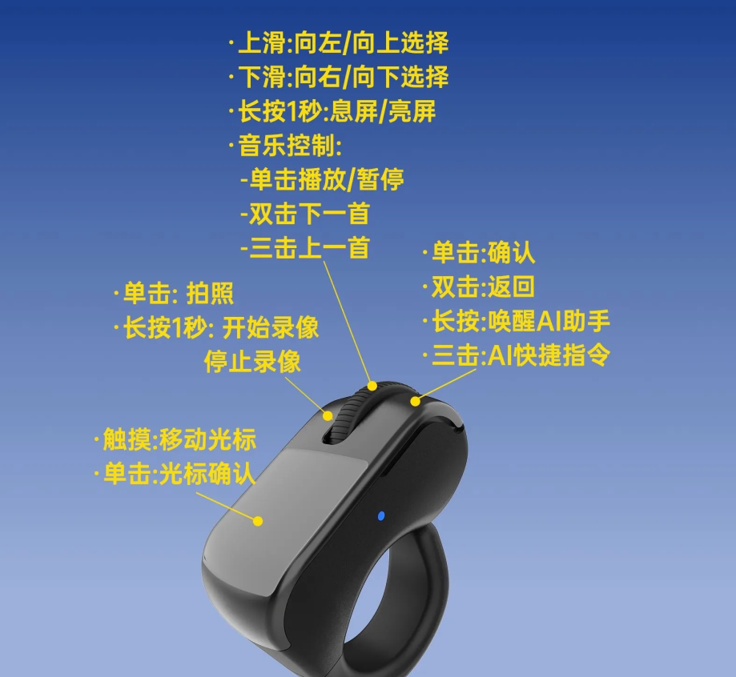
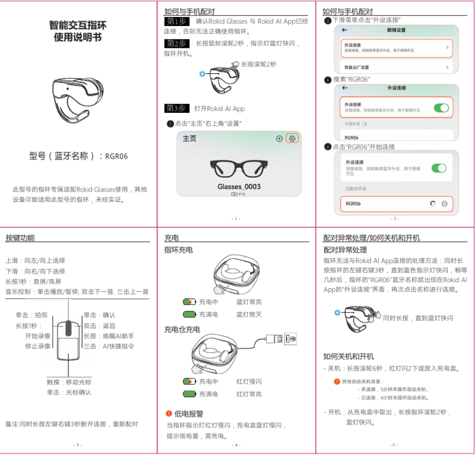

# RGR06 触控板与鼠标映射
use rokid rings on ubuntu

此设备为蓝牙为Rokid AR眼镜的赠品，后续可以参考当前库对其他蓝牙戒指进行按键映射




将当前电脑连接的 RGR06 蓝牙指环转换为 Linux 鼠标。触摸区用于移动光标，实体按键用于点击，滚轮用于滚动。映射由电脑上的前台程序完成。

| 操作 | 默认效果 |
| --- | --- |
| 触摸区滑动 | 相对移动鼠标光标 |
| 左键 | 鼠标左键单击 |
| 右键 | 鼠标右键单击 |
| 滚轮按下 | 鼠标中键单击 |
| 滚轮向前 / 向后 | 向上 / 向下滚动，支持连续转动和同段反向 |

按键效果、滚动方向和触摸灵敏度通过 [rgr06-config.json](rgr06-config.json) 配置。当前支持鼠标左、右、中键及两个滚动方向；任意键盘快捷键和执行脚本不在现有配置范围内。

## 开始使用

首次使用先阅读 [安装与权限设置](install.md)。权限准备好后，在本机终端运行：

```bash
cd /home/longxiaoze/codes/rgr06-tools
python3 rgr06_mapper.py --check
python3 rgr06_mapper.py --run --seconds 3600 --arm-timeout 120
```

按提示轻触并松开 RGR06，等待 `Mapping active` 后使用。`Ctrl+C` 停止并恢复原生输入；上面的命令最多运行一小时。详细参数、自定义和排障见 [运行指南](run.md)。

## 适用范围

本次实测环境为 Ubuntu、GNOME、Wayland。核心程序只使用 Python 标准库，通过 Linux `hidraw`、`evdev` 和 `uinput` 工作。实现限制为 64 位 x86 / ARM Linux ABI；ARM 环境尚未实测。

当前工具绑定这一台设备，按完整身份动态发现节点，不依赖固定的 `event26` 等编号：

| 身份 | 实测值 |
| --- | --- |
| 蓝牙名称 | RGR06 |
| 总线 / VID / PID | Bluetooth / `248a` / `045b` |
| 唯一地址 | `d1:05:cb:5c:37:15` |
| HID 描述符 | 171 字节 |
| 描述符 SHA-256 | `177ec423b4adb8fcd2137ed9476f5d61baa261950aa93b9cb33d25e7f4be02e6` |

身份及描述符会在打开实际设备后再次校验。其他样机或固件需要重新采样和适配；仅修改配置中的地址不足以支持新设备。

## 实现依据与限制

设备通过 HID 发送键盘、媒体键和数位器报告。左右键、滚轮按下及转动使用固件组合序列，程序由统一的动作解析层识别；共同的 F1 前缀不会直接产生点击。连续滚动中的每个完整方向输入转换为一个逻辑滚动单位，末尾方向键只结束该段，不额外滚动。物理每格对应多少逻辑单位尚未标定。

实测滑动报告使用 `InRange`，未设置 `TipSwitch`，因此默认明确选择 `contact_signal: "in_range"`。触控板模式在接触时建立基线，后续坐标差转换为相对移动，抬手清除基线。可选 `touchscreen` 模式输出系统触摸事件；它不会像触控板模式一样移动鼠标箭头。

固件坐标可能在 `0` 或 `4095` 饱和，软件不能恢复已经丢失的运动。物理按住拖拽、部分多击 / 长按宏和其他手势尚未验证或实现；未知序列保留统计，不猜测成鼠标动作。本工具没有写入设备端的持久按键配置，也没有安装自启服务。

## 验证与文件

操作者已在当前电脑确认左键、右键、滚轮按下、触摸移动光标及双向滚动正常。57 项测试通过；完整的 1,468 条原始 HID 报告回放识别出向上 49、向下 51 个逻辑滚动单位，并生成 480 帧相对移动。未实现序列和验证边界见 [验证记录](evidence/validation.json)。

| 文件 | 用途 |
| --- | --- |
| [rgr06_mapper.py](rgr06_mapper.py) | 设备绑定、固件动作识别、虚拟鼠标和生命周期管理 |
| [rgr06_motion.py](rgr06_motion.py) | 触摸坐标到相对移动的转换 |
| [rgr06_capture.py](rgr06_capture.py) | 只读检查与被动原始报文采集 |
| [rgr06_desktop_test.py](rgr06_desktop_test.py) | 可选 GTK 桌面输入验证窗口 |
| [install.md](install.md) | 环境、设备权限及撤销方法 |
| [run.md](run.md) | 日常运行、自定义、采集与排障 |

`evidence/` 保存本机 sysfs、BlueZ、hidraw、evdev 和桌面测试证据。这些是本地采样记录，不是 REA Evidence 记录。核心映射不需要 GTK；可选测试窗口及对应测试需要系统已有的 PyGObject / GTK 3。
